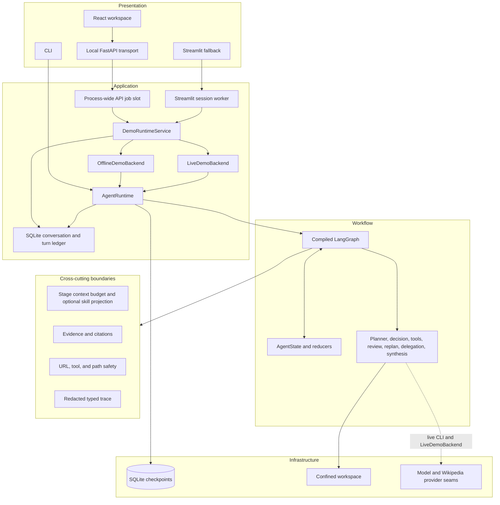
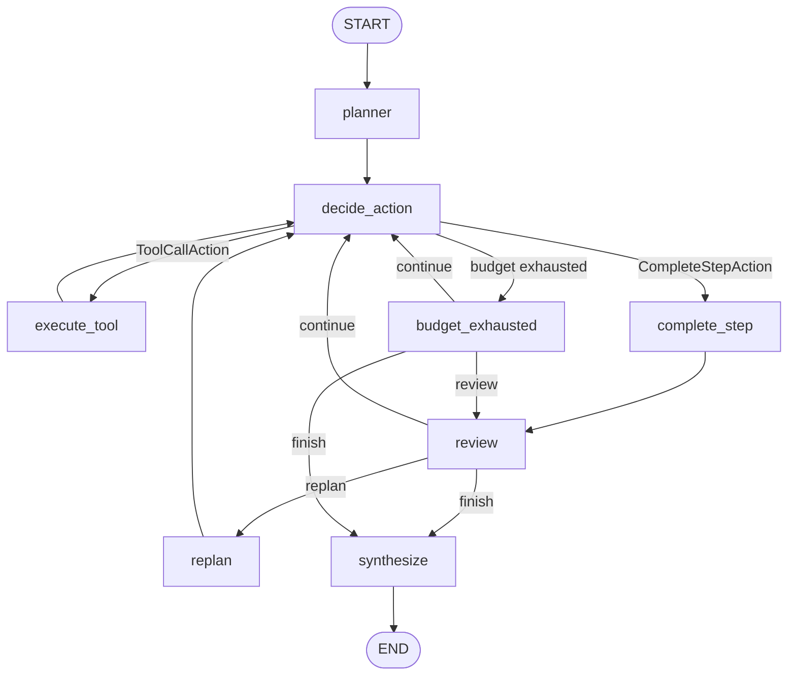

# Mini DeerFlow

> A bounded research-agent learning MVP, independently implemented to explore DeerFlow-style concepts: planning, typed tool execution, evidence, review and replanning, delegation, checkpoint/resume, safety, tracing, and deterministic evaluation.

Mini DeerFlow is a local Python research runtime with three user entry points:

- a live-capable CLI using the configured GLM 5.3 OpenAI-compatible endpoint plus Wikipedia research tools;
- a React/TypeScript research workspace backed by a local FastAPI transport, with live and deterministic offline modes;
- the retained Streamlit reference/fallback interface with the same shared runtime services.

Start the React workspace with the [local setup below](#run-the-react-workspace).
See [React UI migration](docs/react-ui-migration.md) for the architecture, exact
HTTP contracts, parity matrix, browser procedure and final verification record.

It is a local learning MVP—not a production platform, DeerFlow clone, or upstream-compatible implementation. Phase 0 mentor acceptance remains pending; Phase 1 adds explicit skills and bounded context assembly to the existing runtime.

## Project Status

| Area | Status |
| --- | --- |
| Core research-agent runtime | Complete |
| Planning and typed action loop | Complete |
| Evidence and citation membership | Complete |
| Review and bounded replanning | Complete |
| Depth-one bounded delegation | Complete |
| SQLite checkpoint and resume | Complete |
| Persistent multi-turn conversations | Complete |
| Tool, workspace, and fetch safety boundaries | Complete |
| Redacted execution tracing | Complete |
| Deterministic Streamlit mentor demo | Complete |
| React workspace + local FastAPI transport | PASS — automated local migration acceptance, 2026-10-24 |
| Streamlit retirement | Deferred until manual mentor acceptance and a separate cleanup |
| Phase 0 mentor acceptance | Pending |
| Phase 1 context engineering and skills | Implemented; offline verification snapshot below |
| Phase 2 PPTX core (Issue #8, task 2.1) | PASS — automated local acceptance; review APPROVE; manual viewer verification unverified |
| Production deployment | Deferred |
| Upstream DeerFlow parity | Not claimed |

## What It Does

```text
Goal
  ↓
Structured Plan
  ↓
Typed Action
  ↓
Allowlisted Tool
  ↓
Observation
  ↓
Evidence
  ↓
Citation Membership Check
  ↓
Review ──→ Continue / Replan / Finish
  ↓
Optional Delegation and Fan-in
  ↓
Deterministic Synthesis
  ├──→ Concise final_answer (chat + next-turn context)
  └──→ Detailed research_report (artifact + Agent details)
```

1. The planner creates a validated plan with 3–7 consecutively numbered steps.
2. The action selector emits either a typed tool call or a step-completion action.
3. The runtime validates the selected tool, arguments, timeout, and remaining budgets.
4. Successful Wikipedia observations can become bounded `EvidenceRecord` values with provenance.
5. Proposed citations are canonicalized and checked against successful evidence.
6. The reviewer chooses `continue`, `replan`, or `finish`; replan replaces only unfinished work.
7. The parent may run a bounded, depth-one research wave and deterministically fan results in.
8. Synthesis produces a concise public Markdown answer and a separate deterministic
   internal report; only the report can be written through the workspace boundary.

### Evidence is not a raw provider result

Evidence is a structured, bounded record extracted from a successful `wiki_search` or `wiki_lookup` observation in the default runtime. Legacy `web_search`/`web_fetch` evidence remains schema-compatible, but those tools are not registered by default. Each record retains source-tool, step, call, and optional delegation provenance.

### Citation validation is not fact checking

Citation validation establishes one narrow property: the proposed citation's canonical URL is a member of successful evidence. It does not prove factual correctness, semantic entailment, or absolute source quality.

## Architecture

For the canonical Phase 1 user guide, see
[`docs/context-engineering-skills.md`](docs/context-engineering-skills.md): JSON
frontmatter, metadata discovery versus activation, per-turn API/UI selection,
context priorities, durable pins, offline commands and limitations.

New skill activations must satisfy both the 32,768-byte raw UTF-8 instruction limit and the 56,000-character full JSON-serialized snapshot limit; see [activation limits and escaping examples](docs/context-engineering-skills.md#skill-files-discovery-is-not-activation).



The canonical runtime graph is [`src/mini_deerflow/agent_workflow.py`](src/mini_deerflow/agent_workflow.py). [`src/mini_deerflow/workflow.py`](src/mini_deerflow/workflow.py) is a smaller scaffold used by focused workflow tests; it is not the final runtime graph.

Dependency injection is explicit through constructors and factories. The local
FastAPI HTTP API wraps `DemoRuntimeService` and its safe projections; there is no
service container. The API uses one process-wide active job slot across modes,
while Streamlit retains its per-session worker. SQLite owns durable history;
the API's 32 retained job snapshots are process-local and disappear on restart.
Explicit Resume recovers an unresolved persisted turn; startup does not replay it.

## Core Workflow



`AgentState` is a checkpointed `TypedDict` with mutable container semantics. Graph nodes return partial updates, and reducers merge messages, lists, evidence, and citation sources. It is not an immutable state object.

## Key Features

| Area | Implemented capability | Boundary |
| --- | --- | --- |
| Agent execution | Structured planning, typed actions, controlled termination | Per-step, total-call, replan, and recursion limits |
| Tools | Exact-name registry and validated input models | No arbitrary tool execution |
| Evidence | Structured records, canonical URLs, provenance | Only successful schema-shaped web observations qualify |
| Citations | Membership validation and invented-URL rejection | Does not prove truth or entailment |
| Adaptation | Review and bounded replanning | Completed steps and durable evidence are preserved |
| Delegation | 2–3 branches, depth one, budget 1–5 per branch | Web-only branches; no nested delegation or writes |
| Fan-in | Stable branch ordering and citation revalidation | Failed-branch findings are not promoted |
| Persistence | SQLite conversation/turn ledger plus turn-isolated checkpoints | No exactly-once guarantee for external effects |
| Context | Deterministic LLM-facing projections | Character budget; token count is only `ceil(chars / 4)` |
| Skills | Explicit `research-brief`, `deep-research`, or `source-comparison` per turn | Default `None`; repository-local guidance, no permission grants or automatic child inheritance |
| Safety | Tool, session sandbox, fetch-target, and rendering boundaries | Filesystem isolation only, not an OS/container sandbox |
| Observability | Typed ordered trace and safe projections | No raw payload or production telemetry backend |
| User answer | Concise evidence-based Markdown with validated links | No raw execution counters, prompts, or report dump |
| Artifact | Deterministic Markdown, confined write and scoped per-turn HTTP download | No production artifact serving or authenticated ownership |
| Local HTTP workspace | React chat, history/resume, skills and execution inspector; automated local parity verified | Single process, localhost, no authentication; live-provider and manual acceptance unverified |

## Live and offline modes

The React workspace starts in **Offline walkthrough**; Streamlit starts in Live.
The Python live backend reads the GLM-compatible API key,
base URL, and model settings from the local environment or `.env`. GLM 5.3 handles planning,
reasoning, review, and synthesis. Research is intentionally restricted to the public Wikipedia
API through `wiki_search` and `wiki_lookup`; general `web_search`/`web_fetch` tools are not
registered in the default runtime. The UI never displays credentials. Checkpoints are stored under
`.mini-deerflow/live`; each conversation gets a persistent filesystem sandbox under
`.mini-deerflow/live/workspaces/sessions/v1-<sha256(normalized thread_id)>`.

Choose **Offline walkthrough** from the `Execution mode` selector to use the original
deterministic mentor scenario. It is network-free and stores its data under
`.mini-deerflow/demo`.

**Skill for next turn** (React composer / Streamlit sidebar) defaults to **None** and resets after
submission. Each historical turn retains its active skill ID. The original
offline walkthrough uses fixed Phase 0 answers; the separate Phase 1 offline
demo exercises production skill/context request assembly with scripted seams.
It starts with an unskilled baseline using the same goal, then exercises a
skilled interrupted/resumed run and an unskilled follow-up, with a 7,000-character
dynamic context budget:

```powershell
uv run --offline --no-sync python -m mini_deerflow.demo.phase1_offline
```

Run from a provisioned checkout. This demonstrates integration and continuity,
not live LLM quality or mentor acceptance.

### Phase 2 standalone PPTX demo

The [PPTX core guide](docs/phase2-pptx-core.md) documents the eight editable
layouts, three static themes, caller-owned bytes API, independent validator and
final verification results. Task 2.1 has no runtime/API/UI integration. From a
provisioned checkout, use a fresh caller-owned output directory:

```powershell
uv run --offline python -m mini_deerflow.demo.phase2_pptx_offline --output-dir .mini-deerflow/phase2-review-evidence
```

The demo refuses to overwrite `phase2-offline.pptx`. Structural validation is
not visual verification; actual viewer text fit remains unverified. Automated
task 2.1 acceptance passed with final review APPROVE; see the guide for evidence.

Task 2.2 (Issue #10) adds immutable turn-owned PPTX storage and scoped HTTP
downloads. See the [PPTX artifact guide](docs/phase2-pptx-artifacts.md) for API
usage, crash recovery, the credential-free two-mode demo and verification status.
Final automated local acceptance: **PASS**; security review: **APPROVE**, with no
open HIGH/MEDIUM findings. Manual viewer verification remains unverified.

Task 2.3 (Issue #12) adds the Slide Agent backend: model-driven, evidence-grounded
deck planning over a completed research turn, with key-based citation,
URL-free plan text, illustrative-data markers and immutable turn-owned
publication. See the [Slide Agent guide](docs/phase2-slide-agent.md) for the
architecture, skills contract, HTTP API, credential-free demo and verification
status. Final automated acceptance is pending.

Task 2.4 (Issue #14) adds the React presentation workspace: a per-completed-turn
dialog for generating, verifying and downloading evidence-grounded decks. See the
[Presentation workspace guide](docs/phase2-presentation-workspace.md) for the
user journey, truthfulness rules, accessibility evidence and final verification.
Final automated local acceptance: **PASS**. Manual viewer verification remains
unverified.

## Deterministic Mentor Walkthrough

The offline walkthrough is **deterministic**, **localhost-oriented**, and designed for a 5–7 minute mentor walkthrough. It uses the real runtime, workflow, SQLite checkpointer, evidence/citation logic, reviewer/replanner, delegation fan-in, tracing, workspace, and artifact boundary.

Model decisions, provider data, resolver behavior, and trace identity/time are deterministic. Delegated branches use the real `BoundedResearcherSubagent` and registered tool execution with scripted action selection: alpha's `web_search` succeeds, beta's fails safely, and the parent completes after fan-in. The offline backend constructs settings with `_env_file=None`, needs no model credentials, and does not fall back to a live provider.

```mermaid
flowchart LR
    Unsafe[Unsafe fetch denied] --> Failure[Provider failure redacted]
    Failure --> Evidence[Successful evidence]
    Evidence --> Citation[Invented citation rejected]
    Citation --> Replan[Reviewer requests replan]
    Replan --> Wave[Delegation wave]
    Wave --> A[Branch A succeeds]
    Wave --> B[Branch B fails safely]
    A --> FanIn[Deterministic fan-in]
    B --> FanIn
    FanIn --> Answer[Concise user answer]
    FanIn --> Artifact[Internal research report]
    Answer --> FollowUp[Follow-up on the same public thread]
    FollowUp --> NewTurn[New isolated turn and bounded prior context]
```



This scenario demonstrates contracts and failure handling. It is not a benchmark of live research quality.

## Retained Streamlit UI

This section describes the reference/fallback renderer. React exposes per-turn
details through **Inspect** with Graph, Plan, Tools & Delegation, Evidence,
Review, Trace, Context and Artifacts tabs. See the
[full capability matrix](docs/react-ui-migration.md#streamlit-capability-parity-matrix)
for verification references and the remaining live/manual acceptance limits.

The main surface is a persistent chat. `New chat` creates a conversation when the first
message is submitted; later messages call `continue_thread` with the same public
`thread_id` and a new idempotent `turn_id`. Reloading the app reconstructs the transcript
from SQLite rather than from Streamlit session memory.

Each completed assistant message contains only the concise, evidence-based
`final_answer`. A collapsed `🔎 Agent details` expander keeps the execution material
separate. Detail tabs are created only when that turn has relevant data:

| Per-turn tab | Purpose |
| --- | --- |
| Agent graph | Workflow / Current run views, runtime delegation hierarchy, and safe node inspector |
| Execution | Goal, plan, current step, budgets, and limitations |
| Evidence & Citations | Bounded evidence, provenance, accepted citations, and rejected count |
| Delegation | Wave/branch status, budget accounting, and fan-in limitations |
| Review & Replan | Structured verdicts/findings and replacement-step metadata; no raw rationale |
| Trace | Filtered, ordered, safe execution timeline |
| Research report | Structured preview, exact internal Markdown report, and download |

The **Workflow** graph shows possible canonical routes; **Current run** reconstructs
observed execution from structured events, including branch-owned tools and fan-in.
An active job also displays a live graph. Use **Inspect node** to select and highlight
an entity; native chart clicks do not drive the Python inspector. The offline mentor
scenario demonstrates alpha completed, beta failed, and parent completed. See
[`docs/agent-graph.md`](docs/agent-graph.md) for architecture, safety, replay behavior,
and accepted UI limitations.

```text
Runtime state and trace
        ↓
Explicit projector
        ↓
Frozen, allowlisted view models
        ↓
Streamlit renderer
```

The user answer is rendered as sanitized Markdown with HTML disabled, remote images
removed, and links restricted to validated citation URLs. The internal research report
is rendered only as inert code inside the collapsed details panel. The UI does not
directly receive raw prompts, provider exception bodies, arbitrary tool arguments,
checkpoints, SQLite internals, credentials, `.env` content, machine paths, rejected
URLs, or raw trace payloads. This is a tested local-demo boundary, not a production
frontend security claim.

## Multi-turn Runtime Semantics

- `AgentState` belongs to exactly one turn. It is never reused as mutable conversation
  state.
- `run(goal, thread_id, turn_id=...)` creates the conversation and its first turn.
- `continue_thread(thread_id, user_message, turn_id=...)` reserves and executes a new
  turn. Repeating a completed `(thread_id, turn_id)` returns its persisted checkpoint
  without replaying tools.
- `resume(thread_id=...)` only resumes the conversation's active interrupted turn. If
  all turns are complete, it loads the last completed turn for backward compatibility;
  it does not create a follow-up.
- Previous completed user/assistant pairs are projected into a bounded context window
  for planning the next turn. Previous evidence is not promoted into current-turn
  evidence or citation membership.
- `AgentState.final_answer` and the durable ledger response contain only the public
  answer. `AgentState.research_report` retains the deterministic execution report used
  by the confined artifact and `Agent details`; it is never fed into a new turn.
- The SQLite ledger owns conversation metadata, ordered turns, status, tool-call budget,
  safe response text, and redacted trace JSON. LangGraph owns the execution checkpoint
  for each turn.
- New turns pin `active_skill`, `context_budget`, and `context_policy_version` in
  state/checkpoints and in ledger `run_context_json` at reservation time, covering
  interruption before the first checkpoint. Resume preserves those pins and refuses
  incompatible explicit policy versions; a new follow-up defaults to skill `None`.
- Installed LangGraph resets `checkpoint_ns` on a root graph. The runtime therefore
  derives a deterministic internal saver `thread_id` from the public thread and turn
  namespace. The public `thread_id` remains stable in every API, ledger row, trace, and
  UI projection, while root checkpoints remain isolated per turn.

## Requirements and Setup

- Python 3.12 or newer
- [uv](https://docs.astral.sh/uv/)
- Node compatible with Vite 7 (20.19+ or 22.12+) and npm for the React workspace
- API credentials for live CLI/UI mode; the offline walkthrough needs none

```bash
git clone https://github.com/hhtuann/mini-deerflow.git
cd mini-deerflow
uv sync
```

For the live-capable CLI, copy the checked-in example and provide credentials:

```bash
cp .env.example .env
```

PowerShell:

```powershell
Copy-Item .env.example .env
```

Minimum live configuration:

```dotenv
MINI_DEERFLOW_API_KEY=replace-with-your-z-ai-key
MINI_DEERFLOW_BASE_URL=https://api.z.ai/api/coding/paas/v4
MINI_DEERFLOW_MODEL_NAME=glm-5.3
```

Defaults are `glm-5.3` on the Z.AI OpenAI-compatible endpoint, `15` seconds for
Wikipedia requests, and `prompt_json` for structured output. Model name, base URL,
timeouts, temperature, and retry settings remain configurable through the
`MINI_DEERFLOW_` environment variables.
See [`.env.example`](.env.example). Never commit `.env`.

These settings belong to the Python server only. No frontend environment variable
is required; requests use relative `/api`. Never copy credentials into `VITE_*`,
frontend source or browser storage.

## Run the React Workspace

From the repository root, after `uv sync`:

```sh
uv run python -m mini_deerflow.api
```

In a second terminal:

```sh
cd frontend
npm ci
npm run dev
```

Open <http://127.0.0.1:5173>. The API launcher binds `127.0.0.1:8000`;
Vite strictly binds port 5173 and proxies `/api` to the Python server. Run one
API process/worker. CORS permits only HTTP localhost/127.0.0.1 origins on port
5173. This is a local non-authenticated learning interface, not a public service.
Do not run the API and Streamlit concurrently against the same store.

For a key-free journey, keep **Offline walkthrough**, choose an optional skill,
submit a question, follow up, reload and inspect each turn. Offline answers are a
fixed mentor scenario, not arbitrary research. Use **Inspect** to compare Workflow
with Current run, inspect failed/successful branches, evidence, traces and the
real Markdown artifact download. Live mode requires the server configuration above.

See [migration setup and contracts](docs/react-ui-migration.md) and
[`frontend/README.md`](frontend/README.md). `npm run build` produces static output;
the current API does not serve it as an integrated production application.

## Run the Streamlit Fallback

```bash
uv run streamlit run src/mini_deerflow/demo/app.py \
  --server.address 127.0.0.1 \
  --server.headless true \
  --browser.gatherUsageStats false
```

PowerShell:

```powershell
uv run streamlit run src/mini_deerflow/demo/app.py `
  --server.address 127.0.0.1 `
  --server.headless true `
  --browser.gatherUsageStats false
```

For a live mentor demo, keep the default live mode, click **New chat**, submit a
specific research request, wait for the cited answer, then ask a follow-up in the same
chat. The sidebar badge distinguishes a configured live runtime from the network-free
deterministic walkthrough; live readiness is confirmed only after successful model
and Wikipedia-tool outcomes in the run/trace or accepted evidence.

The bind address is a launch configuration; the app does not enforce localhost by itself. The repository also disables Streamlit usage-stat gathering in `.streamlit/config.toml`.

## CLI

Verified commands:

```bash
uv run mini-deerflow --help
uv run mini-deerflow plan --help
uv run mini-deerflow run --help
uv run mini-deerflow resume --help
uv run mini-deerflow threads --help
```

```bash
# Create a validated plan.
uv run mini-deerflow plan "Compare two agent orchestration approaches."

# Run a new persisted thread.
uv run mini-deerflow run \
  "Inspect the workspace and summarize verified evidence." \
  --thread-id research-001

# Resume without supplying a new goal.
uv run mini-deerflow resume --thread-id research-001

# List persisted thread IDs.
uv run mini-deerflow threads
```

`run` and `resume` also expose checkpoint/workspace paths, write opt-in, execution limits, delegation concurrency, and `--trace-json`. `--workspace` is the sandbox base; the CLI resolves the actual file-tool root as `<workspace>/sessions/v1-<sha256(normalized thread_id)>` for both run and resume. Use `uv run mini-deerflow <command> --help` for the verified option list. `write_file` is not model-selectable; when `--allow-write` is enabled, synthesis writes the fixed report artifact through the workspace boundary.

Older raw `<workspace>/<thread_id>` directories are not selected automatically;
migrate them explicitly into the opaque session layout when their contents are
still required.

Upgrade note: the former CLI layout treated `--workspace` as one shared root.
Those files are not assigned to a thread automatically because doing so could
expose one thread's files to another. Move trusted files explicitly into the
intended hashed session directory. The live demo's former
`workspaces/<thread_id>` layout was already per-thread and is retained as a
read/write fallback when no hashed directory exists.

## Persistence and Resume

### Run

`run` creates a new initial state for a validated thread ID. It rejects the request if that thread already has a checkpoint in the selected SQLite database.

### Resume

`resume` restores the checkpointed LangGraph state without replacing the goal. Tests verify that completed work, including completed delegation, is not replayed on the exercised resume path. Resume is not retry semantics.

### External-effect limitation

Checkpoint reuse is not an exactly-once guarantee:

```text
external effect succeeds
        ↓
process crashes before checkpoint persistence
        ↓
resume may repeat the effect
```

Fresh-backend resume is tested in-process. A separate OS-process restart has not been directly verified by the current suite.

## Safety Boundaries

### Tool boundary

Tool input/result models reject unknown fields, the registry is an exact-name allowlist, the runner applies timeouts, and failures are normalized. These are validated closed schemas, not arbitrary execution.

### Workspace boundary

Each normalized public `thread_id` maps deterministically to one persistent filesystem
sandbox at `<sandbox-base>/sessions/v1-<sha256(normalized thread_id)>`. Turns and
resumed execution for that thread reuse the same root and intentionally share files;
different normalized threads receive different roots even when they use the same
relative artifact path. The workspace then rejects absolute paths, traversal,
symlink/junction escapes, and oversized reads/writes.

This boundary applies to file tools and artifacts only. Checkpoints still share one
local SQLite database, there is no authenticated user ownership, and this is not an
OS/container sandbox or production artifact service. Sandboxes are retained so a
thread can resume; automatic cleanup is not implemented.

### Session sandbox mentor check

1. Run threads `sandbox-a` and `sandbox-b` with the same `--workspace` base.
2. Enable writes and let both produce `reports/research-report.md`.
3. Verify the files live under distinct opaque `sessions/` roots.
4. Resume `sandbox-a` and verify its prior artifact remains available.
5. Confirm neither thread can list or read the other's artifact through file tools.

### Web boundary

The legacy, explicitly injected `web_fetch` compatibility seam accepts HTTP(S), rejects userinfo and local/non-public targets, requires resolved addresses to be public, and validates provider-declared redirect/final URL metadata before accepting content into a successful result. It is not registered by the default GLM + Wikipedia runtime.

This is an implemented application-level URL safety boundary, not a claim of complete SSRF, DNS-rebinding, redirect, or production egress protection.

### Trace boundary

Execution traces use a closed typed schema and exclude prompts, queries, URLs, response bodies, excerpts, artifact content, arbitrary payloads, exceptions, and tracebacks. The CLI can emit redacted JSON Lines to stderr; Streamlit consumes a projected FIFO trace queue.

The same trace pipeline now exposes structured execution events for run, node, route,
tool, delegation, branch, evidence, and deterministic fan-in lifecycles. Branch runs carry
parent-run, delegation, branch, and child-tool correlation without adding a UI dependency.
See [`docs/execution-events.md`](docs/execution-events.md) for the hierarchy, safety,
failure, and resume contracts, and [`docs/agent-graph.md`](docs/agent-graph.md) for the
read-only graph projection that consumes them.

## Testing and Evaluation

### Final React/API migration acceptance — 2026-10-24

**PASS — automated local migration acceptance**, relative to base `b5fa5ec`.
Independent final review: **APPROVE**, with no important defects remaining.

| Check | Final result |
| --- | --- |
| Full Python regression (includes 38 API tests) | 816 passed, 6 skipped, 223 subtests; 47.05 seconds |
| Deterministic evaluator | 9 cases / 36 invariants, all passed |
| Phase 1 offline demo | All 14 top-level boolean checks true; unskilled baseline, deep-research interruption/resume, unskilled follow-up |
| Ruff lint / format | PASS / PASS, 124 files already formatted |
| Offline lock validation / diff whitespace | PASS, 95 packages / PASS |
| Frontend `npm ci` | 393 packages audited, 0 vulnerabilities |
| TypeScript / ESLint / Vitest / build | PASS / zero warnings / 20 tests in 4 files / PASS, 2,101 modules |
| Real-API Chromium E2E | 2 passed in 21.4 seconds; cold storage followed by seeded interruption, no mocked backend |

The six Python skips are four symlink cases requiring unavailable Windows
privileges, one Windows native-API case requiring Python 3.13+, and one
POSIX-semantics case. Exact commands are recorded in the
[final verification table](docs/react-ui-migration.md#final-verification-2026-10-24);
frontend scenarios are detailed in [`frontend/VERIFICATION.md`](frontend/VERIFICATION.md).

Real desktop chat, failed-child graph, nonempty Context and 375px phone captures
were visually inspected. The Context capture shows payload **5,592 / 8,000 chars**
with `research-brief`. All seven graph metrics and status/kind legends, trace
multi-select subsets, the explicit Plan goal, safe GFM tables, full resumed
history, active-turn navigation and terminal freshness reconciliation are covered.

Live external-provider execution, manual mentor acceptance, physical mobile
software-keyboard behavior and comprehensive assistive-technology/contrast review
remain unverified. Automated offline acceptance does not establish live-model
quality or production readiness. Streamlit remains the reference/fallback.

Provision Python dependencies with `uv sync` and frontend dependencies with
`npm ci`; Python `--offline --no-sync` checks use the installed environment.
Install Chromium with `npx playwright install chromium` before E2E. Ports 8000
and 5173 must be free; E2E starts isolated API/Vite servers with temporary storage.
Screenshots under `frontend/test-results/` are generated run evidence.

Run pytest commands sequentially when sharing a basetemp: pytest recreates it.
The evaluator runs the cases in `evals/dataset.json` in subprocesses and manages
its own directories under `.mini-deerflow/eval-tmp`; it does not accept a pytest
`--basetemp`. This is deterministic contract evaluation, not a live LLM judge.

Coverage includes unit contracts, graph integration, persistence/resume, URL and workspace safety, context pressure, delegation, trace redaction, final acceptance, Streamlit `AppTest`, offline no-network behavior, and deterministic evaluator cases.

## Project Structure

```text
mini-deerflow/
├── src/mini_deerflow/
│   ├── cli.py                     # CLI entry point
│   ├── api/                       # local FastAPI DTOs, jobs, request boundary
│   ├── runtime.py                 # composition and runtime lifecycle
│   ├── agent_workflow.py          # canonical LangGraph workflow
│   ├── state.py, actions.py       # state and typed actions
│   ├── evidence.py                # evidence, citations, report rendering
│   ├── review.py, replanner.py    # quality loop
│   ├── delegation.py              # bounded research waves and fan-in
│   ├── persistence.py             # SQLite checkpoint boundary
│   ├── web_safety.py              # fetch-target validation
│   ├── tracing.py, workspace.py   # observability and file boundary
│   ├── tools/                     # contracts, registry, runner, tools
│   └── demo/                      # shared services/backends/projections; Streamlit fallback
├── frontend/                      # React/TypeScript/Vite workspace and browser tests
├── docs/react-ui-migration.md      # HTTP contracts, parity and acceptance record
├── tests/                         # unit, integration, system, AppTest
├── evals/                         # deterministic evaluator and dataset
├── pyproject.toml
├── uv.lock
└── README.md
```

## Technology Stack

| Layer | Technology and actual use |
| --- | --- |
| Language | Python 3.12+ / `asyncio`, TypeScript |
| Agent orchestration | LangGraph 1.2.11+ |
| Model integration | LangChain OpenAI-compatible client with GLM 5.3 by default |
| Research source | Wikipedia MediaWiki API via `wiki_search` and `wiki_lookup` |
| Contracts/config | Pydantic 2.13+, pydantic-settings 2.15+ |
| Persistence | SQLite, aiosqlite 0.22+, LangGraph SQLite checkpointer 3.1+ |
| Frontend | React 19, Vite 7, TanStack Query, React Flow/Dagre; Streamlit 1.64+ fallback |
| Local HTTP | FastAPI + Uvicorn, explicit safe DTOs and scoped artifact delivery |
| Background execution | One API-wide active job, single-worker `ThreadPoolExecutor`; retained Streamlit session worker |
| Tests | pytest 9.1+, Streamlit `AppTest`, Vitest/Testing Library, Playwright Chromium |
| Quality/package management | Ruff 0.16+ and uv |

## Important Engineering Decisions

| Decision | Why | Trade-off |
| --- | --- | --- |
| LangGraph | Conditional durable workflow and resume | Framework coupling |
| Typed actions/tools | Reject malformed decisions and inputs | More schema maintenance |
| SQLite checkpoints | Simple local durability | Single-host lifecycle |
| Bounded budgets | Deterministic termination | May stop before ideal evidence depth |
| Context projections | Control exact serialized context size | Character-based, not semantic compression |
| Citation membership | Reject URLs absent from evidence | Does not prove truth or entailment |
| Depth-one delegation | Control amplification and capability | Limited specialization |
| Deterministic fan-in | Stable ordering and failure semantics | Fixed aggregation policy |
| Explicit UI projector | Keep raw runtime data behind an allowlist | Mapping maintenance |
| One API-wide job slot | Bounded local execution, atomic busy rejection across modes | No distributed throughput or cancellation; job history is volatile |
| Offline scenario | Reproducible mentor walkthrough | Does not validate live-provider quality |

## DeerFlow Relationship

Mini DeerFlow is an independent learning implementation inspired by DeerFlow-style research-agent concepts: planning, plan-act-observe, tool-mediated execution, evidence-backed synthesis, review/replanning, bounded delegation, checkpoint/resume, tracing, and artifact generation.

It deliberately simplifies the problem to one local workflow, SQLite persistence,
depth-one homogeneous web branches, deterministic fixtures, and a single-worker
local HTTP workspace with retained Streamlit fallback. It has no agent browser/shell
execution, production scheduler, tenancy layer, or upstream conformance suite.

No claim is made about source compatibility, behavioral equivalence, feature parity, current upstream architecture, or production readiness.

## Production Boundary

| Current MVP | Production direction |
| --- | --- |
| Local SQLite | Managed persistence, migration, backup, retention, HA |
| In-process worker | Durable queue, leases, and distributed workers |
| One active API job across modes/conversations | Multi-user concurrency and quotas |
| No authentication/authorization | Identity and resource policy |
| Per-thread local filesystem sandbox | Authenticated user/session ownership, quotas, retention, and access-controlled artifact storage |
| Local live/offline React/API workspace; Streamlit fallback | Authenticated hosting, explicit live-backend and credential policy |
| Local typed trace | Centralized telemetry and retention controls |
| Application validation | Stronger sandbox and network egress enforcement |
| No cancellation | Cooperative cancellation and compensation |
| Local artifact download | Access-controlled artifact delivery |

## Learning Outcomes

This project exercises:

- stateful agent architecture and LangGraph routing;
- structured model output and tool contracts;
- explicit dependency injection and async resource ownership;
- bounded context projection and execution budgets;
- evidence/citation provenance and deterministic synthesis;
- reviewer-driven replanning and completed-work preservation;
- bounded delegation, partial failure, and fan-in;
- SQLite persistence and resume semantics;
- application-level security boundaries and redacted observability;
- React/HTTP and retained Streamlit frontend/runtime separation;
- deterministic failure-oriented tests and evaluation.

## Current Limitations

- Windows artifact descendants support extended-length I/O; storage roots and SQLite paths must remain host-accessible. See [Windows artifact path portability](docs/windows-artifact-paths.md).
- Live-provider research quality, cost, and latency are not benchmarked by acceptance tests.
- Citation membership does not establish factual correctness or semantic entailment.
- Context accounting is character-based; exact tokenizer accounting is not implemented.
- The bound covers serialized dynamic JSON, excluding static trust instructions,
  message wrappers, provider overhead and output; it is not all-in token metering.
- Bundled skills resolve from the source root, not an installed external registry.
  Integrity checks and static trust instructions do not solve prompt injection.
- Semantic context compression or vector memory is not implemented.
- External side effects do not have an exactly-once guarantee.
- Distributed execution, durable queues, cancellation, auth, and multi-tenancy are absent.
- API job IDs/history are in-memory (32 snapshots); restart requires explicit recovery from durable conversation state.
- Automated local React migration acceptance passed; live-provider, manual mentor, physical software-keyboard and full accessibility acceptance remain unverified.
- Production artifact serving, access control, egress isolation, and telemetry are absent.
- Separate OS-process restart behavior has not been directly exercised.
- Complete SSRF/DNS-rebinding protection is not claimed.

Phase 0 mentor acceptance remains pending. Offline checks do not establish live
LLM validation. Production readiness and DeerFlow parity remain outside scope.
